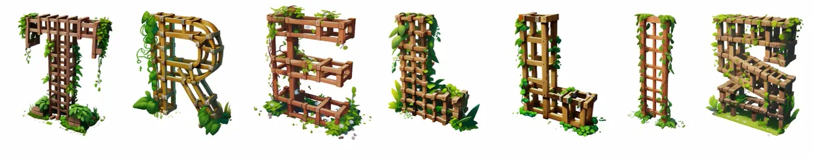
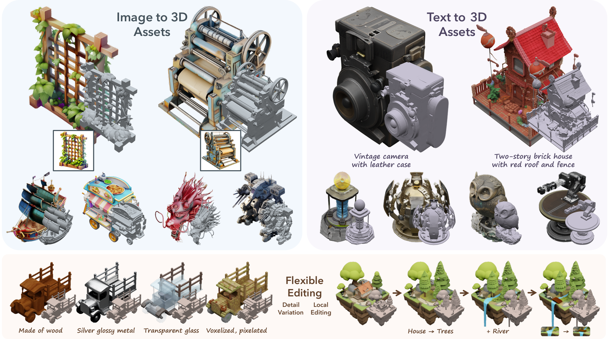

# trellis-mac-mps &mdash; TRELLIS running natively on Apple Silicon

[](https://github.com/vinayapathak/trellis-mac-mps/actions/workflows/tests.yml)

**This is an unofficial port of Microsoft's [TRELLIS](https://github.com/microsoft/TRELLIS) (the original CVPR'25 model) that runs entirely on Apple Silicon Macs — no CUDA, no Linux, no cloud GPU.** Every CUDA-only extension in the original pipeline (sparse convolution, the differentiable rasterizer, the Gaussian splat renderer) has been replaced with a pure-PyTorch/MPS implementation or a hand-written Metal compute kernel. It also adds a local web UI and a CLI on top of the original repo's Gradio-only interface, and a research paper's worth of kernel-, algorithm-, and architecture-level results characterizing *why* Apple Silicon performs the way it does for this workload.

```sh
brew bundle && conda env create -f environment.yml   # one-line install, see Quick start below
```

Jump to: [Results](#-results) · [What's new](#-whats-new-in-this-port) · [Quick start](#quick-start-mac) · [How this compares to other ports](#-how-this-compares-to-other-apple-silicon-ports) · [full paper](paper/) · [full technical log](APPLE_SILICON.md)

---

<!-- Results -->
## 📊 Results

Everything below is measured, not estimated — real repeated-trial benchmarks (n=8–20 independent
runs, 95% confidence intervals where noted) on real Apple Silicon hardware, backed by a paper
(`paper/`) that went through multiple adversarial review passes, including catching and publicly
correcting our own false finding along the way (see [Statistical rigor, including a mistake we
caught and fixed](#statistical-rigor-including-a-mistake-we-caught-and-fixed) below). Full
methodology and every number's provenance: [APPLE_SILICON.md](APPLE_SILICON.md) and `paper/`.

**Real, quantitative framework comparison** — MLX vs. PyTorch MPS vs. `llama.cpp`/GGML, at TRELLIS's own attention shape:

| Framework | Self-attention latency | vs. PyTorch MPS |
|---|---:|---:|
| PyTorch MPS (native SDPA) | 5.465ms | 1.00x (baseline) |
| **MLX** | **1.361ms** | **4.02x faster** |
| `llama.cpp`/GGML | 7.166ms | 1.31x slower |

This pattern holds at a substantially different (Llama-2-7B-like) shape too, but **narrows sharply — not reverses — at a short-sequence shape from a different model family** (ViT-L/14: 4.02x → 1.18x). A cross-hardware check on an NVIDIA H200 helped rule out "short sequences generally erode specialized kernels" as the explanation.

**Real, training-free algorithmic speedups**, both verified across six (image, seed) combinations, structurally and visually:

| Technique | Speedup | What it is |
|---|---:|---|
| CFG difference-caching | **1.17–1.30x** | Diagnosed why naive classifier-free-guidance caching drifts on this sampler family, fixed by caching the *difference* between conditional/unconditional predictions instead of the raw value |
| Sampling step-count reduction | up to **1.98x** | TRELLIS's rectified-flow formulation tolerates fewer steps than its default 25 with no solver change |

**Real architecture-level result** — replacing most self-attention with local windowed attention:

| | Result |
|---|---|
| Full-model speedup | **1.12x**, statistically confirmed (non-overlapping 95% CIs, n=8) |
| Key finding | Window size, not just how many blocks are windowed, determines whether this helps *or hurts* — the window size naively assumed reasonable is actually 2.1x *slower* than full attention in isolation |
| Quality after distillation | Mixed but modest: 2 of 5 geometry/appearance channels land at or below a natural seed-variance noise floor; the other 3 sit 10–31% above it |

**Kernel-level (honest negative result, reported anyway)**: hand-written `matmul2d` kernels using Apple's new Metal Performance Primitives do **not** reliably beat PyTorch's existing `MPSGraph` backend on this hardware — only full int8×int8 quantization reaches parity, and the best hand-written flash-attention kernel still lands at 1.17x native latency after closing an 8-fold gap through iterative optimization. This ceiling motivated the framework comparison and algorithmic work above, which is where the real wins were.

#### Statistical rigor, including a mistake we caught and fixed

Every headline number above carries a real, computed confidence interval or an explicit
noise-floor comparison — not because it's expected of a README, but because an earlier draft's
single-run measurement at the ViT-L/14 shape showed the *opposite* result (PyTorch faster than
MLX). Before trusting it, it was independently re-run 8 more times; every re-run showed MLX
faster. The original measurement was a noise artifact, not a real effect, and the paper reports
the correction openly rather than quietly swapping in the right number. Full account:
[APPLE_SILICON.md](APPLE_SILICON.md) and `research.md`.

---

<!-- What's new -->
## 🍎 What's new in this port

| | |
|---|---|
| **Runs on** | Apple Silicon (M-series) Macs, via PyTorch's MPS backend + a hand-written Metal kernel for the one hot path pure PyTorch wasn't fast enough for |
| **No CUDA required** | Every `.cuda()` call and CUDA-only extension (`diffoctreerast` excepted — see below) replaced with an MPS-native or pure-PyTorch equivalent |
| **New interfaces** | A local Flask web UI (`python3 cli.py serve`) with live progress and an in-browser 3D viewer, plus a scriptable CLI (`python3 cli.py generate`) — upstream only ships a Gradio demo |

### Benchmarks

All numbers below are from real end-to-end pipeline runs on the same Mac, same input image (`object2_vase.png`, 692K-face raw decoded mesh → 34.6K faces after decimation), not synthetic microbenchmarks. Full methodology, additional objects, and the investigation behind each fix: [APPLE_SILICON.md](APPLE_SILICON.md).

| Stage | Before | After | Speedup |
|---|---:|---:|---:|
| **Full pipeline, end to end** (image → textured .glb + .ply) | 901.2s (15.0 min) | 365.4s (6.1 min) | **2.47x** |
| Mesh preview render (30 frames, 692K-face raw mesh) | 181.5s | 4.2s | **~43x** |
| Hole-filling visibility pass (1000 views @ 1024², ~35K-face mesh) | ~300–320s (~3.2 it/s) | 21.0s (47.1 it/s) | **~14–15x** |

The speedup is a **tile-based binning rasterizer** (`trellis/renderers/metal_rasterizer_binned.py`): triangles are binned into 32×32 screen-space tiles by bounding box before rasterizing, so each pixel only tests the triangles actually near it instead of every triangle in the mesh — the same two-stage bin-then-rasterize architecture nvdiffrast's own CUDA rasterizer uses ([Laine & Karras, *High-Performance Software Rasterization on GPUs*](https://research.nvidia.com/sites/default/files/pubs/2011-08_High-Performance-Software-Rasterization/laine2011hpg_paper.pdf)). It's a drop-in replacement, not an approximation — output is bit-identical to the brute-force kernel it replaced, verified in `scripts/verify_metal_rasterizer_binned.py`.

An earlier attempt at this same bottleneck (batching redundant MPS↔CPU syncs) looked correct and measured faster in isolation, but produced **zero** measurable improvement on the real workload — the kernel's own O(H×W×F) compute dwarfed the sync cost it targeted. It was reverted rather than kept as dead complexity; APPLE_SILICON.md documents the dead end alongside what actually worked, since "verified correct + faster in a microbenchmark" turned out not to be sufficient evidence on its own.

A second, independent bug was found and fixed along the way: `pyvista`'s default mesh decimator (`vtkQuadricDecimation`) silently no-ops on certain non-manifold meshes rather than erroring — one test mesh got a **0.0%** reduction instead of the requested 95%, quietly sending a 658K-face mesh through the rest of postprocessing. Fixed with an automatic fallback to `vtkDecimatePro`, which handles the same input correctly.

### Quick start (Mac)

**Prerequisites**: an Apple Silicon Mac (M1 or newer), macOS 13+, and Xcode Command Line Tools (`xcode-select -p` should print a path — if not, run `xcode-select --install` first; needed for the Metal compiler this port's hand-written kernels use). No CUDA Toolkit, no NVIDIA GPU, no Linux.

Three ways to get the Python environment set up — pick one:

**Option A — Homebrew + conda** (recommended if you don't already have conda):
```sh
git clone --recurse-submodules https://github.com/vinayapathak/trellis-mac-mps.git
cd trellis-mac-mps
brew bundle                              # installs conda (via miniconda cask) + git
conda env create -f environment.yml      # creates the `trellis-mac-mps` conda env
conda activate trellis-mac-mps
```

**Option B — conda only** (if you already have conda/miniconda installed):
```sh
git clone --recurse-submodules https://github.com/vinayapathak/trellis-mac-mps.git
cd trellis-mac-mps
conda env create -f environment.yml
conda activate trellis-mac-mps
```

**Option C — plain pip / venv** (no conda at all):
```sh
git clone --recurse-submodules https://github.com/vinayapathak/trellis-mac-mps.git
cd trellis-mac-mps
python3 -m venv .venv && source .venv/bin/activate
pip install -r requirements-test.txt
```

Then, with any of the three:
```sh
export SPARSE_BACKEND=pytorch ATTN_BACKEND=sdpa   # required before importing trellis

# Verify the install (18 correctness/smoke tests, ~2-3 min, no model download needed):
for f in tests/*.py; do python3 "$f" || echo "FAILED: $f"; done

python3 cli.py generate assets/example_image/typical_creature_dragon.png dragon
# -> outputs/dragon.glb, outputs/dragon.ply

python3 cli.py serve
# -> http://127.0.0.1:5050, upload an image, watch it generate, view the result in-browser
```

The `flexicubes` submodule ships as an empty placeholder if you didn't `--recurse-submodules`; if `git submodule update --init` doesn't populate it either (this isn't always a checkout submodule commands work against), see [APPLE_SILICON.md](APPLE_SILICON.md#quick-start) for the manual fallback. Full dependency rationale, troubleshooting, and the complete list of what was ported and why: [APPLE_SILICON.md](APPLE_SILICON.md). Real, passing CI for this exact install path runs on every push — see the badge at the top of this repo's GitHub page.

### 🆚 How this compares to other Apple Silicon ports

A few other community projects also get TRELLIS-family models running on Apple Silicon, and Microsoft itself has an open (unmerged, as of this writing) PR adding native Apple Silicon support to TRELLIS.2 upstream. Worth knowing which one fits what you need, stated plainly:

| | This repo (`trellis-mac-mps`) | [`trellis-mac`](https://github.com/shivampkumar/trellis-mac) | [`trellis2-apple`](https://github.com/pedronaugusto/trellis2-apple) | [microsoft/TRELLIS.2#175](https://github.com/microsoft/TRELLIS.2/pull/175) |
|---|---|---|---|---|
| **Model** | Original TRELLIS (CVPR'25, [microsoft/TRELLIS](https://github.com/microsoft/TRELLIS)) | TRELLIS.2 | TRELLIS.2 | TRELLIS.2 |
| **Compute path** | PyTorch MPS + hand-written Metal kernels (`matmul2d`/MPP) | PyTorch MPS, pure-Python fallbacks, optional Metal texture baker | MLX backend | PyTorch MPS + Metal extensions (builds on both projects to its left), open PR against upstream |
| **What it's for** | Getting it running **and** characterizing/optimizing performance — kernel-level, algorithmic, and architecture-level results, real measured numbers, an accompanying research paper | Getting it running end-to-end on Mac at all | Getting it running end-to-end via MLX | Landing Apple Silicon support in the official repo |
| **Depth** | Custom quantized-matmul and flash-attention Metal kernels, CFG-caching, windowed-attention distillation, statistically-rigorous benchmarking | Inference pipeline compatibility | Inference pipeline compatibility | Inference pipeline compatibility, upstream integration/CLI/diagnostics |

Short version: if you just want to generate 3D assets on your Mac, any of these will do it (once #175 lands, it'll likely be the easiest path for TRELLIS.2 specifically). If you want to understand *why* Apple Silicon performs the way it does for this class of model — where hand-written kernels help, where they don't, and what actually moves the needle, backed by real repeated-trial measurements rather than "it ran successfully" — that's what this repo and its accompanying paper are about, and it's true regardless of how the TRELLIS.2 ecosystem consolidates. See [APPLE_SILICON.md](APPLE_SILICON.md) for the full technical record and `paper/` for the write-up.

---

<details>
<summary><b>Upstream Microsoft TRELLIS README (unmodified — model description, dataset, training, license, citation)</b></summary>

The model itself and its outputs are entirely unchanged by this port — only *where* it runs is
different. This section is Microsoft's own README content, kept for completeness.


<h1 align="center">Structured 3D Latents<br>for Scalable and Versatile 3D Generation</h1>
<p align="center"><a href="https://arxiv.org/abs/2412.01506"></a>
<a href='https://microsoft.github.io/TRELLIS/'></a>
<a href='https://huggingface.co/spaces/Microsoft/TRELLIS'></a>
</p>
<p align="center"></p>

<span style="font-size: 16px; font-weight: 600;">T</span><span style="font-size: 12px; font-weight: 700;">RELLIS</span> is a large 3D asset generation model. It takes in text or image prompts and generates high-quality 3D assets in various formats, such as Radiance Fields, 3D Gaussians, and meshes. The cornerstone of <span style="font-size: 16px; font-weight: 600;">T</span><span style="font-size: 12px; font-weight: 700;">RELLIS</span> is a unified Structured LATent (<span style="font-size: 16px; font-weight: 600;">SL</span><span style="font-size: 12px; font-weight: 700;">AT</span>) representation that allows decoding to different output formats and Rectified Flow Transformers tailored for <span style="font-size: 16px; font-weight: 600;">SL</span><span style="font-size: 12px; font-weight: 700;">AT</span> as the powerful backbones. We provide large-scale pre-trained models with up to 2 billion parameters on a large 3D asset dataset of 500K diverse objects. <span style="font-size: 16px; font-weight: 600;">T</span><span style="font-size: 12px; font-weight: 700;">RELLIS</span> significantly surpasses existing methods, including recent ones at similar scales, and showcases flexible output format selection and local 3D editing capabilities which were not offered by previous models.

***Check out our [Project Page](https://microsoft.github.io/TRELLIS/) for more videos and interactive demos!***

<!-- Features -->
## 🌟 Features
- **High Quality**: It produces diverse 3D assets at high quality with intricate shape and texture details.
- **Versatility**: It takes text or image prompts and can generate various final 3D representations including but not limited to *Radiance Fields*, *3D Gaussians*, and *meshes*, accommodating diverse downstream requirements.
- **Flexible Editing**: It allows for easy editings of generated 3D assets, such as generating variants of the same object or local editing of the 3D asset.

<!-- Updates -->
## ⏩ Updates

**03/25/2025**
- Release training code.
- Release **TRELLIS-text** models and asset variants generation.
  - Examples are provided as [example_text.py](example_text.py) and [example_variant.py](example_variant.py).
  - Gradio demo is provided as [app_text.py](app_text.py).
  - *Note: It is always recommended to do text to 3D generation by first generating images using text-to-image models and then using TRELLIS-image models for 3D generation. Text-conditioned models are less creative and detailed due to data limitations.*

**12/26/2024**
- Release [**TRELLIS-500K**](https://github.com/microsoft/TRELLIS#-dataset) dataset and toolkits for data preparation.

**12/18/2024**
- Implementation of multi-image conditioning for **TRELLIS-image** model. ([#7](https://github.com/microsoft/TRELLIS/issues/7)). This is based on tuning-free algorithm without training a specialized model, so it may not give the best results for all input images.
- Add Gaussian export in `app.py` and `example.py`. ([#40](https://github.com/microsoft/TRELLIS/issues/40))

<!-- Installation -->
## 📦 Installation

### Prerequisites
- **System**: The code is currently tested only on **Linux**.  For windows setup, you may refer to [#3](https://github.com/microsoft/TRELLIS/issues/3) (not fully tested).
- **Hardware**: An NVIDIA GPU with at least 16GB of memory is necessary. The code has been verified on NVIDIA A100 and A6000 GPUs.  
- **Software**:   
  - The [CUDA Toolkit](https://developer.nvidia.com/cuda-toolkit-archive) is needed to compile certain submodules. The code has been tested with CUDA versions 11.8 and 12.2.  
  - [Conda](https://docs.anaconda.com/miniconda/install/#quick-command-line-install) is recommended for managing dependencies.  
  - Python version 3.8 or higher is required. 

### Installation Steps
1. Clone the repo:
    ```sh
    git clone --recurse-submodules https://github.com/microsoft/TRELLIS.git
    cd TRELLIS
    ```

2. Install the dependencies:
    
    **Before running the following command there are somethings to note:**
    - By adding `--new-env`, a new conda environment named `trellis` will be created. If you want to use an existing conda environment, please remove this flag.
    - By default the `trellis` environment will use pytorch 2.4.0 with CUDA 11.8. If you want to use a different version of CUDA (e.g., if you have CUDA Toolkit 12.2 installed and do not want to install another 11.8 version for submodule compilation), you can remove the `--new-env` flag and manually install the required dependencies. Refer to [PyTorch](https://pytorch.org/get-started/previous-versions/) for the installation command.
    - If you have multiple CUDA Toolkit versions installed, `PATH` should be set to the correct version before running the command. For example, if you have CUDA Toolkit 11.8 and 12.2 installed, you should run `export PATH=/usr/local/cuda-11.8/bin:$PATH` before running the command.
    - By default, the code uses the `flash-attn` backend for attention. For GPUs do not support `flash-attn` (e.g., NVIDIA V100), you can remove the `--flash-attn` flag to install `xformers` only and set the `ATTN_BACKEND` environment variable to `xformers` before running the code. See the [Minimal Example](#minimal-example) for more details.
    - The installation may take a while due to the large number of dependencies. Please be patient. If you encounter any issues, you can try to install the dependencies one by one, specifying one flag at a time.
    - If you encounter any issues during the installation, feel free to open an issue or contact us.
    
    Create a new conda environment named `trellis` and install the dependencies:
    ```sh
    . ./setup.sh --new-env --basic --xformers --flash-attn --diffoctreerast --spconv --mipgaussian --kaolin --nvdiffrast
    ```
    The detailed usage of `setup.sh` can be found by running `. ./setup.sh --help`.
    ```sh
    Usage: setup.sh [OPTIONS]
    Options:
        -h, --help              Display this help message
        --new-env               Create a new conda environment
        --basic                 Install basic dependencies
        --train                 Install training dependencies
        --xformers              Install xformers
        --flash-attn            Install flash-attn
        --diffoctreerast        Install diffoctreerast
        --spconv                Install spconv
        --mipgaussian           Install mip-splatting
        --kaolin                Install kaolin
        --nvdiffrast            Install nvdiffrast
        --demo                  Install all dependencies for demo
    ```

<!-- Pretrained Models -->
## 🤖 Pretrained Models

We provide the following pretrained models:

| Model | Description | #Params | Download |
| --- | --- | --- | --- |
| TRELLIS-image-large | Large image-to-3D model | 1.2B | [Download](https://huggingface.co/microsoft/TRELLIS-image-large) |
| TRELLIS-text-base | Base text-to-3D model | 342M | [Download](https://huggingface.co/microsoft/TRELLIS-text-base) |
| TRELLIS-text-large | Large text-to-3D model | 1.1B | [Download](https://huggingface.co/microsoft/TRELLIS-text-large) |
| TRELLIS-text-xlarge | Extra-large text-to-3D model | 2.0B | [Download](https://huggingface.co/microsoft/TRELLIS-text-xlarge) |

*Note: It is always recommended to use the image conditioned version of the models for better performance.*

*Note: All VAEs are included in **TRELLIS-image-large** model repo.*

The models are hosted on Hugging Face. You can directly load the models with their repository names in the code:
```python
TrellisImageTo3DPipeline.from_pretrained("microsoft/TRELLIS-image-large")
```

If you prefer loading the model from local, you can download the model files from the links above and load the model with the folder path (folder structure should be maintained):
```python
TrellisImageTo3DPipeline.from_pretrained("/path/to/TRELLIS-image-large")
```

<!-- Usage -->
## 💡 Usage

### Minimal Example

Here is an [example](example.py) of how to use the pretrained models for 3D asset generation.

```python
import os
# os.environ['ATTN_BACKEND'] = 'xformers'   # Can be 'flash-attn' or 'xformers', default is 'flash-attn'
os.environ['SPCONV_ALGO'] = 'native'        # Can be 'native' or 'auto', default is 'auto'.
                                            # 'auto' is faster but will do benchmarking at the beginning.
                                            # Recommended to set to 'native' if run only once.

import imageio
from PIL import Image
from trellis.pipelines import TrellisImageTo3DPipeline
from trellis.utils import render_utils, postprocessing_utils

# Load a pipeline from a model folder or a Hugging Face model hub.
pipeline = TrellisImageTo3DPipeline.from_pretrained("microsoft/TRELLIS-image-large")
pipeline.cuda()

# Load an image
image = Image.open("assets/example_image/T.png")

# Run the pipeline
outputs = pipeline.run(
    image,
    seed=1,
    # Optional parameters
    # sparse_structure_sampler_params={
    #     "steps": 12,
    #     "cfg_strength": 7.5,
    # },
    # slat_sampler_params={
    #     "steps": 12,
    #     "cfg_strength": 3,
    # },
)
# outputs is a dictionary containing generated 3D assets in different formats:
# - outputs['gaussian']: a list of 3D Gaussians
# - outputs['radiance_field']: a list of radiance fields
# - outputs['mesh']: a list of meshes

# Render the outputs
video = render_utils.render_video(outputs['gaussian'][0])['color']
imageio.mimsave("sample_gs.mp4", video, fps=30)
video = render_utils.render_video(outputs['radiance_field'][0])['color']
imageio.mimsave("sample_rf.mp4", video, fps=30)
video = render_utils.render_video(outputs['mesh'][0])['normal']
imageio.mimsave("sample_mesh.mp4", video, fps=30)

# GLB files can be extracted from the outputs
glb = postprocessing_utils.to_glb(
    outputs['gaussian'][0],
    outputs['mesh'][0],
    # Optional parameters
    simplify=0.95,          # Ratio of triangles to remove in the simplification process
    texture_size=1024,      # Size of the texture used for the GLB
)
glb.export("sample.glb")

# Save Gaussians as PLY files
outputs['gaussian'][0].save_ply("sample.ply")
```

After running the code, you will get the following files:
- `sample_gs.mp4`: a video showing the 3D Gaussian representation
- `sample_rf.mp4`: a video showing the Radiance Field representation
- `sample_mesh.mp4`: a video showing the mesh representation
- `sample.glb`: a GLB file containing the extracted textured mesh
- `sample.ply`: a PLY file containing the 3D Gaussian representation


### Web Demo

[app.py](app.py) provides a simple web demo for 3D asset generation. Since this demo is based on [Gradio](https://gradio.app/), additional dependencies are required:
```sh
. ./setup.sh --demo
```

After installing the dependencies, you can run the demo with the following command:
```sh
python app.py
```

Then, you can access the demo at the address shown in the terminal.


<!-- Dataset -->
## 📚 Dataset

We provide **TRELLIS-500K**, a large-scale dataset containing 500K 3D assets curated from [Objaverse(XL)](https://objaverse.allenai.org/), [ABO](https://amazon-berkeley-objects.s3.amazonaws.com/index.html), [3D-FUTURE](https://tianchi.aliyun.com/specials/promotion/alibaba-3d-future), [HSSD](https://huggingface.co/datasets/hssd/hssd-models), and [Toys4k](https://github.com/rehg-lab/lowshot-shapebias/tree/main/toys4k), filtered based on aesthetic scores. Please refer to the [dataset README](DATASET.md) for more details.


<!-- Training -->
## 🏋️‍♂️ Training

TRELLIS’s training framework is organized to provide a flexible and modular approach to building and fine-tuning large-scale 3D generation models. The training code is centered around `train.py` and is structured into several directories to clearly separate dataset handling, model components, training logic, and visualization utilities.

### Code Structure

- **train.py**: Main entry point for training.
- **trellis/datasets**: Dataset loading and preprocessing.
- **trellis/models**: Different models and their components.
- **trellis/modules**: Custom modules for various models.
- **trellis/pipelines**: Inference pipelines for different models.
- **trellis/renderers**: Renderers for different 3D representations.
- **trellis/representations**: Different 3D representations.
- **trellis/trainers**: Training logic for different models.
- **trellis/utils**: Utility functions for training and visualization.

### Training Setup

1. **Prepare the Environment:**
   - Ensure all training dependencies are installed.
   - Use a Linux system with an NVIDIA GPU (The models are trained on NVIDIA A100 GPUs).
   - For distributed training, verify that your nodes can communicate through the designated master address and port.

2. **Dataset Preparation:**
   - Organize your dataset similar to TRELLIS-500K. Specify your dataset path using the `--data_dir` argument when launching training.

3. **Configuration Files:**
   - Training hyperparameters and model architectures are defined in configuration files under the `configs/` directory.
   - Example configuration files include:

| Config | Pretained Model | Description |
| --- | --- | --- |
| [`vae/ss_vae_conv3d_16l8_fp16.json`](configs/vae/ss_vae_conv3d_16l8_fp16.json) | [Encoder](https://huggingface.co/microsoft/TRELLIS-image-large/blob/main/ckpts/ss_enc_conv3d_16l8_fp16.safetensors) [Decoder](https://huggingface.co/microsoft/TRELLIS-image-large/blob/main/ckpts/ss_dec_conv3d_16l8_fp16.safetensors) | Sparse structure VAE |
| [`vae/slat_vae_enc_dec_gs_swin8_B_64l8_fp16.json`](configs/vae/slat_vae_enc_dec_gs_swin8_B_64l8_fp16.json) | [Encoder](https://huggingface.co/microsoft/TRELLIS-image-large/blob/main/ckpts/slat_enc_swin8_B_64l8_fp16.safetensors) [Decoder](https://huggingface.co/microsoft/TRELLIS-image-large/blob/main/ckpts/slat_dec_gs_swin8_B_64l8gs32_fp16.safetensors) | SLat VAE with Gaussian Decoder |
| [`vae/slat_vae_dec_rf_swin8_B_64l8_fp16.json`](configs/vae/slat_vae_dec_rf_swin8_B_64l8_fp16.json) | [Decoder](https://huggingface.co/microsoft/TRELLIS-image-large/blob/main/ckpts/slat_dec_rf_swin8_B_64l8r16_fp16.safetensors) | SLat Radiance Field Decoder |
| [`vae/slat_vae_dec_mesh_swin8_B_64l8_fp16.json`](configs/vae/slat_vae_dec_mesh_swin8_B_64l8_fp16.json) | [Decoder](https://huggingface.co/microsoft/TRELLIS-image-large/blob/main/ckpts/slat_dec_mesh_swin8_B_64l8m256c_fp16.safetensors) | SLat Mesh Decoder |
| [`generation/ss_flow_img_dit_L_16l8_fp16.json`](configs/generation/ss_flow_img_dit_L_16l8_fp16.json) | [Denoiser](https://huggingface.co/microsoft/TRELLIS-image-large/blob/main/ckpts/ss_flow_img_dit_L_16l8_fp16.safetensors) | Image conditioned sparse structure Flow Model |
| [`generation/slat_flow_img_dit_L_64l8p2_fp16.json`](configs/generation/slat_flow_img_dit_L_64l8p2_fp16.json) | [Denoiser](https://huggingface.co/microsoft/TRELLIS-image-large/blob/main/ckpts/slat_flow_img_dit_L_64l8p2_fp16.safetensors) | Image conditioned SLat Flow Model |
| [`generation/ss_flow_txt_dit_B_16l8_fp16.json`](configs/generation/ss_flow_txt_dit_B_16l8_fp16.json) | [Denoiser](https://huggingface.co/microsoft/TRELLIS-text-base/blob/main/ckpts/ss_flow_txt_dit_B_16l8_fp16.safetensors) | Base text-conditioned sparse structure Flow Model |
| [`generation/slat_flow_txt_dit_B_64l8p2_fp16.json`](configs/generation/slat_flow_txt_dit_B_64l8p2_fp16.json) | [Denoiser](https://huggingface.co/microsoft/TRELLIS-text-base/blob/main/ckpts/slat_flow_txt_dit_B_64l8p2_fp16.safetensors) | Base text-conditioned SLat Flow Model |
| [`generation/ss_flow_txt_dit_L_16l8_fp16.json`](configs/generation/ss_flow_txt_dit_L_16l8_fp16.json) | [Denoiser](https://huggingface.co/microsoft/TRELLIS-text-large/blob/main/ckpts/ss_flow_txt_dit_L_16l8_fp16.safetensors) | Large text-conditioned sparse structure Flow Model |
| [`generation/slat_flow_txt_dit_L_64l8p2_fp16.json`](configs/generation/slat_flow_txt_dit_L_64l8p2_fp16.json) | [Denoiser](https://huggingface.co/microsoft/TRELLIS-text-large/blob/main/ckpts/slat_flow_txt_dit_L_64l8p2_fp16.safetensors) | Large text-conditioned SLat Flow Model |
| [`generation/ss_flow_txt_dit_XL_16l8_fp16.json`](configs/generation/ss_flow_txt_dit_XL_16l8_fp16.json) | [Denoiser](https://huggingface.co/microsoft/TRELLIS-text-xlarge/blob/main/ckpts/ss_flow_txt_dit_XL_16l8_fp16.safetensors) | Extra-large text-conditioned sparse structure Flow Model |
| [`generation/slat_flow_txt_dit_XL_64l8p2_fp16.json`](configs/generation/slat_flow_txt_dit_XL_64l8p2_fp16.json) | [Denoiser](https://huggingface.co/microsoft/TRELLIS-text-xlarge/blob/main/ckpts/slat_flow_txt_dit_XL_64l8p2_fp16.safetensors) | Extra-large text-conditioned SLat Flow Model |

### Command-Line Options

The training script can be run as follows:
```sh
usage: train.py [-h] --config CONFIG --output_dir OUTPUT_DIR [--load_dir LOAD_DIR] [--ckpt CKPT] [--data_dir DATA_DIR] [--auto_retry AUTO_RETRY] [--tryrun] [--profile] [--num_nodes NUM_NODES] [--node_rank NODE_RANK] [--num_gpus NUM_GPUS] [--master_addr MASTER_ADDR] [--master_port MASTER_PORT]

options:
  -h, --help                    show this help message and exit
  --config CONFIG               Experiment config file
  --output_dir OUTPUT_DIR       Output directory
  --load_dir LOAD_DIR           Load directory, default to output_dir
  --ckpt CKPT                   Checkpoint step to resume training, default to latest
  --data_dir DATA_DIR           Data directory
  --auto_retry AUTO_RETRY       Number of retries on error
  --tryrun                      Try run without training
  --profile                     Profile training
  --num_nodes NUM_NODES         Number of nodes
  --node_rank NODE_RANK         Node rank
  --num_gpus NUM_GPUS           Number of GPUs per node, default to all
  --master_addr MASTER_ADDR     Master address for distributed training
  --master_port MASTER_PORT     Port for distributed training
```

### Example Training Commands

#### Single-node Training

To train a image-to-3D stage 2 model with a single machine.
```sh
python train.py \
  --config configs/vae/slat_vae_dec_mesh_swin8_B_64l8_fp16.json \
  --output_dir outputs/slat_vae_dec_mesh_swin8_B_64l8_fp16_1node \
  --data_dir /path/to/your/dataset1,/path/to/your/dataset2 \
```
The script will automatically distribute the training across all available GPUs. Specify the number of GPUs with the `--num_gpus` flag if you want to limit the number of GPUs used.

#### Multi-node Training

To train a image-to-3D stage 2 model with multiple GPUs across nodes (e.g., 2 nodes):
```sh
python train.py \
  --config configs/generation/slat_flow_img_dit_L_64l8p2_fp16.json \
  --output_dir outputs/slat_flow_img_dit_L_64l8p2_fp16_2nodes \
  --data_dir /path/to/your/dataset1,/path/to/your/dataset2 \
  --num_nodes 2 \
  --node_rank 0 \
  --master_addr $MASTER_ADDR \
  --master_port $MASTER_PORT
```
Be sure to adjust `node_rank`, `master_addr`, and `master_port` for each node accordingly.

#### Resuming Training

By default, training will resume from the latest saved checkpoint in the same output directory. To specify a specific checkpoint to resume from, use the `--load_dir` and `--ckpt` flags:
```sh
python train.py \
  --config configs/generation/slat_flow_img_dit_L_64l8p2_fp16.json \
  --output_dir outputs/slat_flow_img_dit_L_64l8p2_fp16_resume \
  --data_dir /path/to/your/dataset1,/path/to/your/dataset2 \
  --load_dir /path/to/your/checkpoint \
  --ckpt [step]
```

### Additional Options

- **Auto Retry:** Use the `--auto_retry` flag to specify the number of retries in case of intermittent errors.
- **Dry Run:** The `--tryrun` flag allows you to check your configuration and environment without launching full training.
- **Profiling:** Enable profiling with the `--profile` flag to gain insights into training performance and diagnose bottlenecks.

Adjust the file paths and parameters to match your experimental setup.


<!-- License -->
## ⚖️ License

TRELLIS models and the majority of the code are licensed under the [MIT License](LICENSE). The following submodules may have different licenses:
- [**diffoctreerast**](https://github.com/JeffreyXiang/diffoctreerast): We developed a CUDA-based real-time differentiable octree renderer for rendering radiance fields as part of this project. This renderer is derived from the [diff-gaussian-rasterization](https://github.com/graphdeco-inria/diff-gaussian-rasterization) project and is available under the [LICENSE](https://github.com/JeffreyXiang/diffoctreerast/blob/master/LICENSE).


- [**Modified Flexicubes**](https://github.com/MaxtirError/FlexiCubes): In this project, we used a modified version of [Flexicubes](https://github.com/nv-tlabs/FlexiCubes) to support vertex attributes. This modified version is licensed under the [LICENSE](https://github.com/nv-tlabs/FlexiCubes/blob/main/LICENSE.txt).


<!-- Citation -->
## 📜 Citation

If you find this work helpful, please consider citing our paper:

```bibtex
@article{xiang2024structured,
    title   = {Structured 3D Latents for Scalable and Versatile 3D Generation},
    author  = {Xiang, Jianfeng and Lv, Zelong and Xu, Sicheng and Deng, Yu and Wang, Ruicheng and Zhang, Bowen and Chen, Dong and Tong, Xin and Yang, Jiaolong},
    journal = {arXiv preprint arXiv:2412.01506},
    year    = {2024}
}
```

</details>

